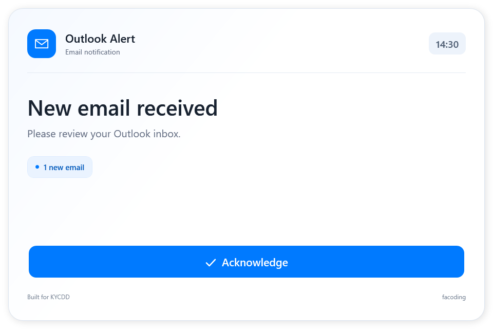
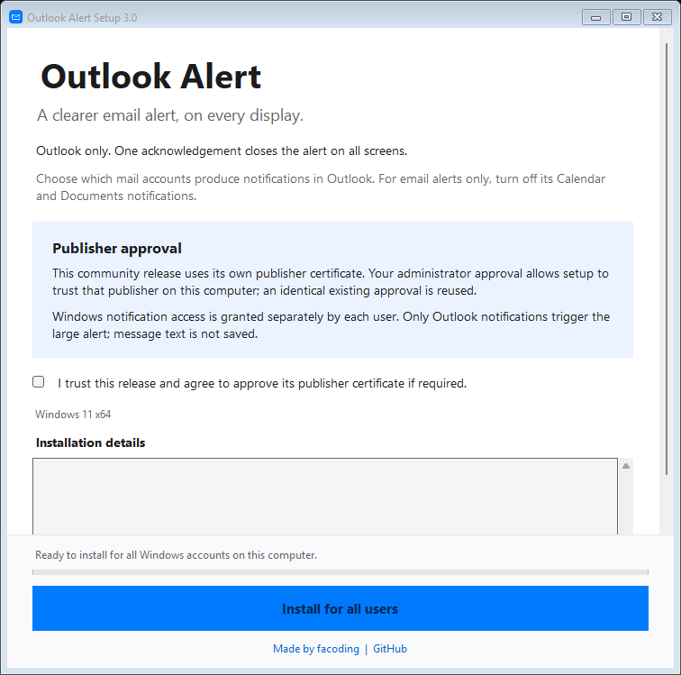

# Outlook Alert

A Windows desktop app that makes new Outlook mail easier to notice when you work across several screens.

When New Outlook posts a Windows notification, Outlook Alert displays a large card on every connected display. The card stays visible until you acknowledge it. One click closes the cards on all screens.

[Windows releases](https://github.com/faCoding97/Outlook-Alert-FaCoding/releases) · [Installation guide](docs/INSTALLATION.md) · [Build from source](docs/BUILDING.md) · [Privacy](docs/PRIVACY.md)

## What it does

- Shows a clear, persistent alert on each display in an extended desktop.
- Uses a light interface with blue controls and rounded corners.
- Shows **“New email received”** and **“Please review your Outlook inbox.”**
- Closes every alert when you acknowledge one of them.
- Plays your choice of five notification sounds, with a Silent option and a sound test.
- Starts automatically at Windows sign-in, with its actual Windows startup state shown in settings.
- Filters the exact installed New Outlook application identity, so Telegram, WhatsApp and other apps cannot trigger its large alert.
- Uses Windows notification events instead of repeatedly scanning open application windows.
- Keeps notification access and settings separate for each Windows user.

It is useful when Outlook is minimized, you often switch between applications, or you miss a small notification on another monitor.

Installer source rendered during the Windows layout check. The footer stays reachable when the window is resized.

Version **3.2.0 (pre-release)** adds selectable sounds and fixes startup registration being skipped when monitoring setup is incomplete. Windows sign-in, audio playback, multi-profile provisioning and first-use permission still need a Windows 11 device check.

## Requirements

- Windows 11, x64.
- **New Outlook for Windows** installed for the Windows user who will use the app.
- Outlook desktop notifications enabled in both Outlook and Windows.
- Permission for Outlook Alert to access Windows notifications.

The installer includes the app runtime. You do not need Visual Studio, a .NET SDK or a separate PowerShell script to use the installed app. Classic Outlook is not currently supported by the source-identity filter.

## Install and start

1. Download `OutlookAlert-Setup-3.2.0.exe` from the release files provided with this version.
2. Double-click setup and approve Administrator access, or choose **Run as administrator**. Select the publisher consent and **Install for all users**.
3. In your own normal Windows session, open **Outlook Alert** from Start, select **Enable monitoring**, and allow Windows notification access.
4. Check that monitoring is ready and that the displayed startup status is enabled. Startup registration no longer depends on notification permission succeeding.
5. Send a **new** test email after monitoring becomes ready.

Use **Test sound** to hear the selected tone and **Test appearance on all screens** to preview the card. A real incoming email is needed to check the complete notification path.

For a computer with several Windows accounts, install once as Administrator, then complete notification permission and Outlook notification settings in **each** account. Windows does not let one user grant another user's notification permission. See the [installation guide](docs/INSTALLATION.md) for the release's exact registration and removal behavior.

### About the signing certificate

This community build uses its own code-signing publisher certificate. It is not signed by Microsoft or a public certificate authority. Setup explains and requests consent before trusting its included publisher certificate. The certificate is a publisher leaf in **Trusted People**, not a root certificate authority.

Only approve an installer obtained from a release you trust. Organization-managed computers may require IT approval. The app separately requests Windows notification access when monitoring is enabled.

## Choose which Outlook mailboxes trigger alerts

Outlook Alert recognizes the application that sent a Windows notification. It cannot reliably identify the receiving mailbox or distinguish mail from every other Outlook notification type.

To receive alerts only for selected email accounts:

1. In New Outlook, open **Settings → General → Notifications**.
2. Expand **Notifications in Outlook** and select only the accounts you want to monitor.
3. Enable **Mail** desktop notifications. Turn off **Calendar** and **Documents** notifications if you want email alerts only.
4. In **Windows Settings → System → Notifications**, allow Outlook notifications and notification banners.

A shared mailbox must produce its own Outlook desktop notifications. Depending on its configuration, you may need to add or promote it as an account rather than access it only as a shared folder.

These choices control Outlook notifications on that Windows profile. Disabling an account here also disables its ordinary Outlook desktop notifications.

## Everyday use

Closing the settings window leaves Outlook Alert in the system tray. Its tray menu provides settings/status, an appearance test, a shortcut to Outlook and **Exit Outlook Alert**.

Choose **Chime**, **Bell**, **Double beep**, **Soft ping**, **Urgent** or **Silent** in settings. The choice is saved for your Windows account. Sounds play once when new alerts arrive, with a two-second cooldown for bursts, rather than once per display. Acknowledging an alert stops its sound. The tones are included in the app and need no download.

The alert stays above ordinary desktop applications until acknowledged. It is shown on the displays available to the current Windows session; mirrored displays share the same desktop surface.

Startup settings show the actual Windows state and provide enable, disable and Windows Startup settings actions. If Windows marks startup as disabled by you or by organization policy, the app reports that state and does not override it.

**Exit** stops monitoring until the app is opened again or enabled startup runs at a later sign-in. Automatic startup is not a Windows service or a crash-restarting watchdog. The app does not monitor while the PC is off, sleeping or signed out.

## Privacy

The app does not sign in to your mailbox, ask for an email password, read email bodies or send notification data to a server. It uses the notification's source identity, ID and creation time. Windows grants the notification-list capability at system level; the app checks the exact New Outlook identity before processing an alert.

A small local diagnostic log records status, error codes and processing timings. It does not record message text, senders, subjects or full notification contents. See [Privacy and data handling](docs/PRIVACY.md).

## Limits and troubleshooting

- Outlook must create a Windows notification. A message arriving silently in the Inbox cannot trigger this app.
- Existing notifications are baselined at launch rather than displayed as newly received mail.
- The counter represents newly detected Outlook notifications. Outlook may group several emails into one notification.
- Windows controls when notification events are delivered. A particular response time is not guaranteed.
- Events can be missed while the app is stopped or while Windows is asleep.
- Windows permission, organization policy, notification settings and the current session can affect operation.

If the appearance test works but a new email does not trigger a card, first check whether the ordinary Outlook desktop notification appeared. Then check monitoring status and Windows notification access. The local diagnostic log can help separate event delivery, lookup and display delays.

More steps are in [Troubleshooting](docs/TROUBLESHOOTING.md).

## Source and releases

The project source is available in this repository. Installer binaries belong in [GitHub Releases](https://github.com/faCoding97/Outlook-Alert-FaCoding/releases), rather than in the source tree. Release notes and checksums should accompany each installer.

See [Build from source](docs/BUILDING.md) for the project layout, build commands and signing requirements. Private signing keys and local build caches are excluded from the repository.

## License

No open-source license has been selected. Copyright (c) 2026 facoding. All rights reserved.

Third-party components retain their own applicable licenses and notices, which are included with the distributed runtime.

## Credits

Developed by facoding for KYCDD, initially for work across multiple displays. Available for other New Outlook users.

[facoding on GitHub](https://github.com/faCoding97)

Outlook Alert is an independent project and is not affiliated with or endorsed by Microsoft. Outlook and Windows are Microsoft trademarks.
